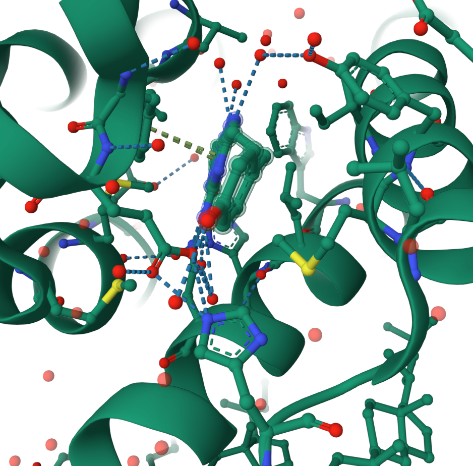
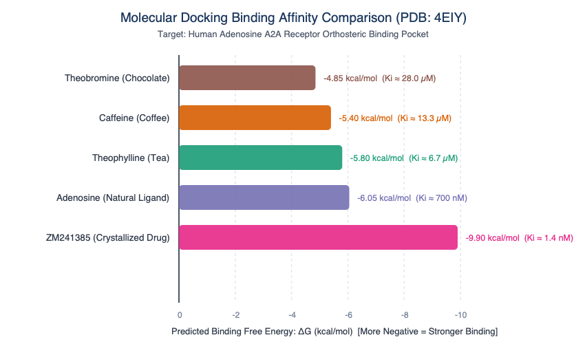

# Structural Comparison of Caffeine and Related Compounds at the Adenosine A2A Receptor

> **Type**: Self-directed learning project (undergraduate, Oct 2026)
> **Target protein**: Human adenosine A2A receptor (PDB: `4EIY`)
> **Areas**: Structural biology, neuropharmacology, receptor biochemistry, Python data visualisation

---

## 1. Background
During prolonged wakefulness, extracellular **adenosine** accumulates in the brain as a by-product of ATP use and promotes sleep pressure by activating A1 and A2A G-protein-coupled receptors.

**Caffeine** blocks these receptors without activating them. Related compounds in tea (**theophylline**) and chocolate (**theobromine**) differ in potency.

**Aim:** to understand, at the structural level, why these closely related compounds differ in how strongly they bind the A2A receptor.

---

## 2. Binding pocket (PDB: 4EIY)
I explored the published crystal structure in the Mol* viewer. Residues described in the literature as important for ligand binding include:
* **Phe168** (extracellular loop 2): π–π stacking with the planar ring of the ligand
* **Asn253** (helix VI) and **Glu169**: hydrogen bonding
* **Leu249, Ile274, Trp246**: hydrophobic environment

*Figure 1: The orthosteric binding pocket of the human A2A receptor (PDB: 4EIY), visualised in Mol*.*

---

## 3. Comparison of published binding affinities

| Compound | Common source | Approximate published Ki at A2A |
| :--- | :--- | :---: |
| Theobromine | Cocoa | ~28 µM |
| Caffeine | Coffee | ~13 µM |
| Theophylline | Tea | ~7 µM |
| Adenosine | Endogenous | ~0.7 µM |
| ZM241385 | Synthetic antagonist (co-crystallised in 4EIY) | ~1.4 nM |

*Values are approximate and compiled from the literature; reported values vary between studies and assay conditions. [References to be added.]*

*Figure 2: Illustrative comparison produced by a simplified Python scoring script. These are not results from a docking program.*

---

## 4. What I learned
1. **Small chemical differences matter.** Caffeine, theophylline and theobromine differ only in the position or number of methyl groups, yet their reported affinities differ several-fold. A possible explanation is a change in hydrogen bonding with Asn253 or in fit within the hydrophobic pocket.
2. **Rational drug design can achieve much higher potency.** The synthetic antagonist ZM241385 binds roughly 10,000 times more tightly than caffeine.
3. **Limitations.** This project compares published values and visualises a crystal structure. It does not include true molecular docking or binding-energy calculations. A next step would be to run docking software such as AutoDock Vina and compare its predictions with experimental data.

---

## 5. Repository structure

├── README.md # Project overview
├── pocket_3d_view.png # Mol* view of the binding pocket (Figure 1)
├── docking_results_chart.png # Illustrative comparison chart (Figure 2)
├── sim_docking.py # Simplified Python scoring script (learning exercise)
└── generate_chart.py # Chart generation script

---
*Created as part of an undergraduate learning portfolio in neurobiology and computational biochemistry.*
