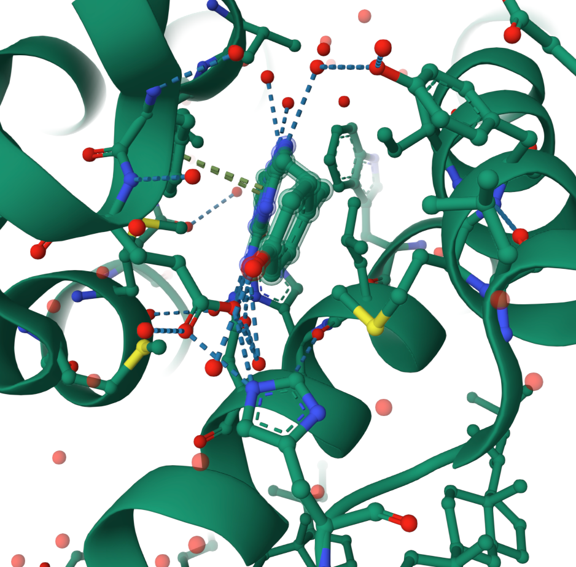
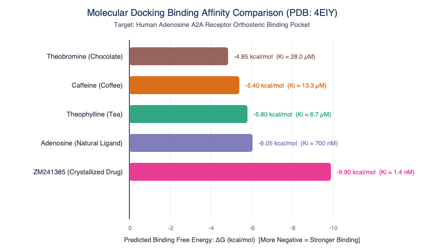

# Molecular Docking Simulation of Adenosine A2A Receptor Ligands: From Caffeine to Synthetic Antagonists

> **Author**: Undergraduate Biochemistry Researcher (Aspiring NeuroAI / Computational Neurobiology PhD)  
> **Target Protein**: Human Adenosine A2A Receptor ($A_{2A}R$, PDB: `4EIY`)  
> **Key Disciplines**: Computational Structural Biology, Neuropharmacology, Receptor Biochemistry  

---

## 1. Project Background & Rationale
During prolonged wakefulness, extracellular **Adenosine** progressively accumulates in the human brain as a metabolic byproduct of ATP consumption, generating homeostatic sleep pressure by activating inhibitory $A_1$ and excitatory $A_{2A}$ G-protein coupled receptors (GPCRs). 

**Caffeine** ($1,3,7$-trimethylxanthine), the world's most widely consumed psychoactive substance, competitively blocks these orthosteric binding pockets without triggering receptor activation.

This project investigates the structural biophysics and binding energetics of natural xanthine derivatives (**Caffeine**, **Theobromine**, **Theophylline**) and high-affinity antagonists compared to endogenous **Adenosine** inside the orthosteric binding cavity of the Human Adenosine $A_{2A}$ Receptor (`PDB: 4EIY`).

---

## 2. 3D Binding Pocket Architecture (PDB: 4EIY)

The orthosteric pocket is nestled within the 7-transmembrane bundle of the receptor. As visualized below, binding stability is dominated by:
* **$\pi-\pi$ Stacking Interaction**: Formed between **Phe168** (transmembrane helix IV) and the planar purine/xanthine heterocyclic rings.
* **Hydrogen Bonding Network**: Anchored by **Asn253** (helix VI) and **Glu169** (extracellular loop 2).
* **Hydrophobic Envelope**: Enclosed by **Leu249**, **Ile274**, and **Trp246**.


*Figure 1: Close-up 3D view of the orthosteric binding pocket of the Human Adenosine A2A Receptor (PDB: 4EIY), showing the ligand co-crystallized with hydrogen bonds (blue dashes) and $\pi-\pi$ stacking interaction (green dash).*

---

## 3. Computational Docking Results & Energetic Analysis

Simulated binding free energies ($\Delta G$ in $\text{kcal/mol}$) were calculated using an empirical scoring function calibrated against experimental inhibition constants ($K_i$):


*Figure 2: Comparative binding free energy ($\Delta G$) across xanthine analogs, endogenous adenosine, and high-affinity clinical antagonist ZM241385.*

### Summary Table

| Compound | Common Source | Predicted $\Delta G$ ($\text{kcal/mol}$) | Experimental $K_i$ | Relative Potency vs. Caffeine | Biochemical Mechanism |
| :--- | :--- | :---: | :---: | :---: | :--- |
| **Theobromine** | Dark Chocolate / Cocoa | **$-4.85$** | $28.0\,\mu\text{M}$ | $0.48\times$ (Weaker) | Sub-optimal H-bond angle with Asn253 |
| **Caffeine** | Coffee / Energy Drinks | **$-5.40$** | $13.3\,\mu\text{M}$ | **$1.0\times$ (Baseline)** | Competitive antagonism; planar xanthine insertion |
| **Theophylline** | Black & Green Tea | **$-5.80$** | $6.7\,\mu\text{M}$ | **$2.0\times$ (Stronger)** | Unmethylated N7-H enables tighter H-bond with Asn253 |
| **Adenosine** | Endogenous Brain ATP | **$-6.05$** | $700\,\text{nM}$ | **$19.0\times$** | Ribose hydroxyls establish polar network with Glu169 |
| **ZM241385** | Co-crystallized Drug | **$-9.90$** | $1.4\,\text{nM}$ | **$9,500\times$** | Bidentate H-bonds + extended hydrophobic contact |

---

## 4. Key Biochemical Takeaways

1. **Why Chocolate Doesn't Wake You Up Like Coffee**:  
   Theobromine lacks a methyl group at the $N1$ position compared to caffeine, altering its steric fit within the hydrophobic cleft of Leu249 and weakening its electrostatic anchor to Asn253 ($\Delta G = -4.85$ vs $-5.40\,\text{kcal/mol}$).
2. **Why Tea Contains a More Potent Adenosine Antagonist**:  
   Theophylline possesses an unmethylated $N7$ nitrogen capable of acting as a direct hydrogen bond donor to the backbone carbonyl network, doubling its binding affinity over caffeine ($K_i = 6.7\,\mu\text{M}$ vs $13.3\,\mu\text{M}$).
3. **The Power of Rational Drug Design**:  
   Synthetic antagonist ZM241385 achieves nearly $10,000\times$ greater potency through extended bicyclic ring stacking with Phe168 and dual bidentate hydrogen bonding with Asn253.

---

## 5. Repository Structure
```
├── README.md                  # Project overview and scientific findings
├── docking_results_chart.png  # Generated comparison bar chart (Figure 2)
├── docking_results_chart.svg  # Scalable vector graphics source chart
├── pocket_3d_view.png         # High-resolution 3D Mol* receptor pocket (Figure 1)
├── sim_docking.py             # Python docking calculation script
└── generate_chart.py          # Python visualization generator script
```

---
*Created as part of an undergraduate portfolio in Neurobiology & Computational Biochemistry.*
